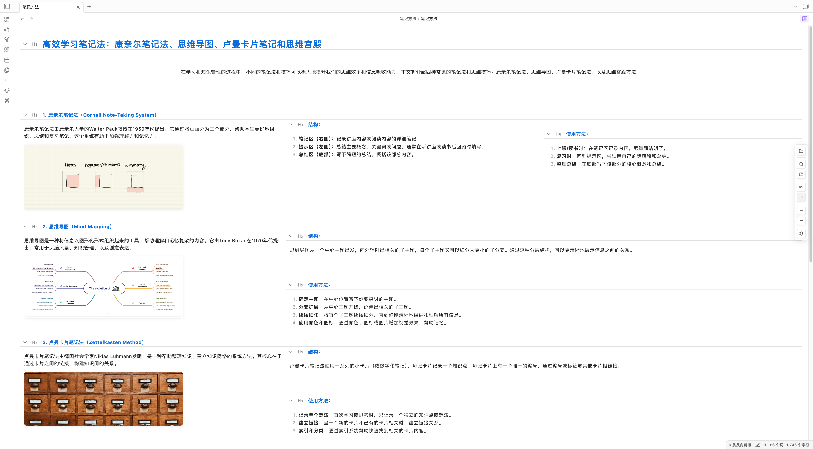
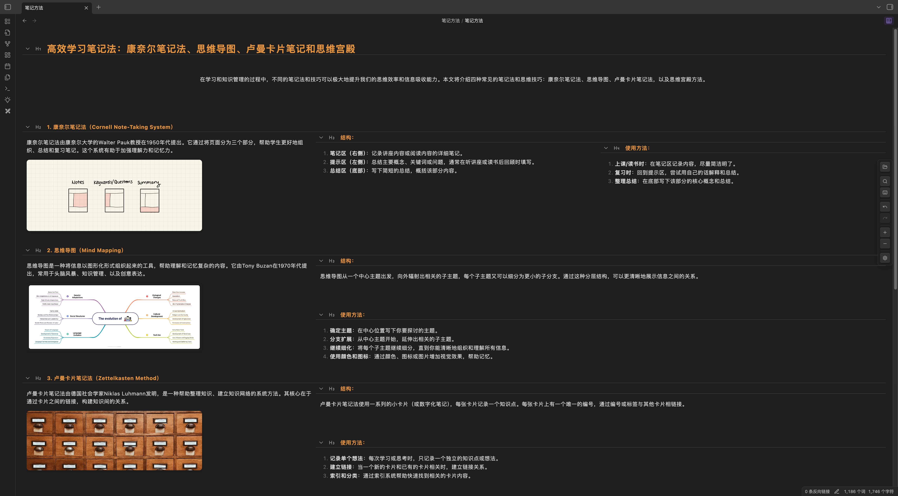

# Grid Note

Grid Note 是一个桌面端 Obsidian 插件，用树状卡片视图重构 Markdown 阅读与编辑流程。源码以 [MIT](./LICENSE) 协议完全开源。

[](images/image-white.png)

[](images/image-black.png)

## 功能特性

- **树状卡片视图**：将 Markdown 标题（H1–H6）转换为层级卡片结构，长文档保持可扫读
- **内联编辑**：选中卡片直接编辑，CodeMirror 语法高亮，自动同步到底层 Markdown 源码
- **文本搜索**：全文搜索 + 高亮 + 计数，键盘快速跳转
- **导航与快捷键**：方向键在父子/兄弟节点间移动，`K` 打开快捷键面板
- **复制与分享**：按卡片/子树复制纯文本或富文本，导出为图片
- **截图合成器**：自定义层级深度、字体、清晰度后导出 PNG，保存到 Vault 或剪贴板
- **范围编辑**：聚焦单个节点在弹窗中编辑子树
- **文件树浏览器**：快速浏览与切换仓库内文件
- **折叠状态持久化**：按文件记忆折叠状态，重排标题后仍能恢复

## 安装

### 方式一：BRAT（推荐）

1. 安装 [BRAT](https://github.com/TfTHacker/obsidian42-brat) 插件
2. BRAT 设置 → `Add Beta plugin` → 输入 `Dcx199302/Obsidian-GridNote-Plugin`
3. 在社区插件列表启用 **Grid Note**

### 方式二：手动安装

1. 从 [Releases](https://github.com/Dcx199302/Obsidian-GridNote-Plugin/releases) 下载 `obsidian-gridnote-<version>.zip`
2. 解压到 `.obsidian/plugins/grid-note/`
3. 在 Obsidian 设置中启用插件

## 开发环境

- Node.js 20+
- npm
- Obsidian 0.15.0+（桌面端）

## 常用命令

```bash
npm install
npm run test
npm run test:extended
npm run check
npm run build
npm run dev
```

- `npm run test`：运行当前最小单元测试集
- `npm run test:extended`：运行扩展测试集
- `npm run check`：Svelte 类型检查
- `npm run build`：完整检查并产出 `main.js`
- `npm run dev`：启动 esbuild watch

## 发布流程

- 发布产物固定为 `main.js`、`manifest.json`、`styles.css`
- 推送 tag 后由 [release.yml](.github/workflows/release.yml) 自动构建并在当前仓库创建 Release

### 1. 准备版本

1. 修改 `package.json` 中的 `version`
2. 执行 `npm run version` 同步 `manifest.json` 与 `versions.json`
3. 运行 `npm run test && npm run build` 验证
4. 提交并推送版本变更

### 2. 打 tag 并推送

```bash
git tag "v2.2.0"
git push origin "v2.2.0"
```

tag 推荐统一使用 `v<version>` 格式（不带 `v` 前缀也可识别）。

### 3. GitHub Actions 自动执行

1. Node.js 20 + `npm ci` 安装依赖
2. `npm run build` 构建
3. 校验 `main.js`、`manifest.json`、`styles.css` 存在
4. 生成 `obsidian-gridnote-<version>.zip`
5. 校验 tag 与 `manifest.json` 版本一致
6. 在当前仓库创建 Release 并上传 `main.js`、`manifest.json`、`styles.css`、zip

### 4. 失败排查

- `Version mismatch`：tag 去掉 `v` 前缀后必须与 `manifest.json` 的 `version` 完全一致
- Release 缺少文件：确认本地 `npm run build` 实际生成了 `main.js`
- workflow 无权限：确认使用默认 `GITHUB_TOKEN` 且具有 `contents: write`

## 仓库结构

- `src/main.ts`：插件入口
- `src/views/`：Markdown 模式管理与视图交互
- `src/components/`：Svelte 界面组件
- `src/processor/`：Markdown 文档解析
- `src/utils/`：编辑、搜索、截图、折叠状态等工具
- `styles.css`：插件静态样式
- `images/`：文档截图

## 说明

- 本插件仅支持桌面端 Obsidian
- 源码以 [MIT](./LICENSE) 协议开源

## License

[MIT](./LICENSE) © ChengDong Xu
