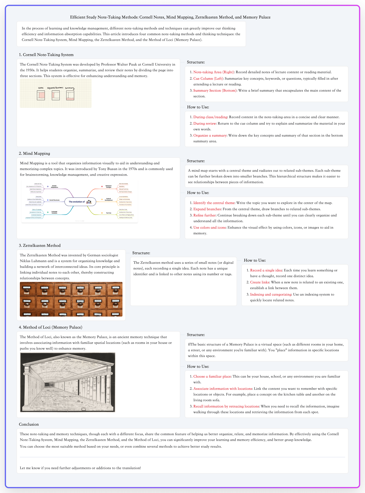

# Grid Note

**A focused tree-card view for Markdown — built for reading, learning, and structured thinking.**



## Why Grid Note

Long documents are hard to scan. Grid Note turns every heading into a card arranged as an interactive tree — keep the big picture while diving into details.

- **Tree-card reading** — H1–H6 become foldable cards you can navigate and search
- **Inline editing** — click a card to edit with CodeMirror, always in sync with the source
- **Fast navigation** — arrow keys move between parents, siblings, and children
- **Full-text search** — live highlights and match counters across the document
- **Copy & share** — export any card or subtree as Markdown, rich text, or PNG
- **File tree browser** — browse and jump between vault files

## Installation

**Community plugins** — search "Grid Note" in Obsidian's community plugin directory (once listed).

**BRAT**

1. Install [BRAT](https://github.com/TfTHacker/obsidian42-brat)
2. Add `Dcx199302/Obsidian-GridNote-Plugin` as a Beta plugin
3. Enable Grid Note

**Manual**

1. Download `obsidian-gridnote-<version>.zip` from [Releases](https://github.com/Dcx199302/Obsidian-GridNote-Plugin/releases)
2. Extract to `.obsidian/plugins/grid-note/`
3. Enable the plugin in Obsidian settings

## 中文简介

Grid Note 将 Markdown 转换为树状卡片视图，支持内联编辑、全文搜索与图片导出，适合长文档阅读与结构化学习。

## Development

```bash
npm install
npm run test
npm run build
```

Requires Node.js 20+ and Obsidian 0.15.0+ (desktop only).

## License

[MIT](./LICENSE) © ChengDong Xu
